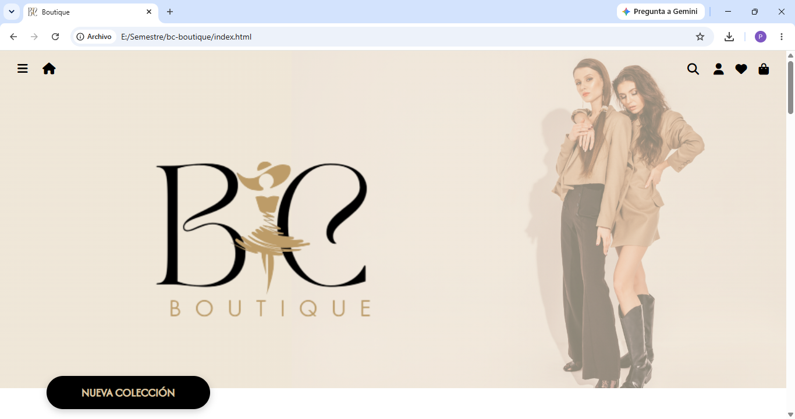
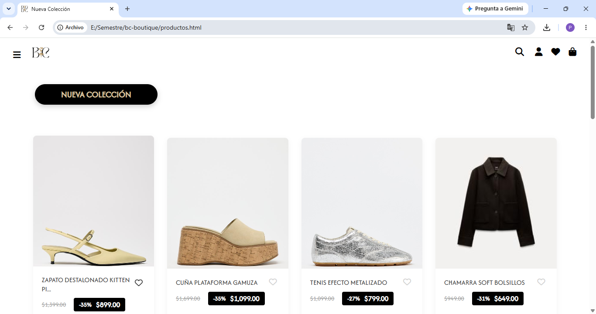
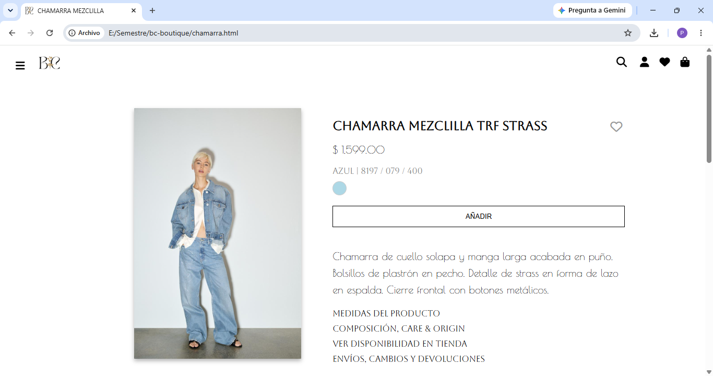
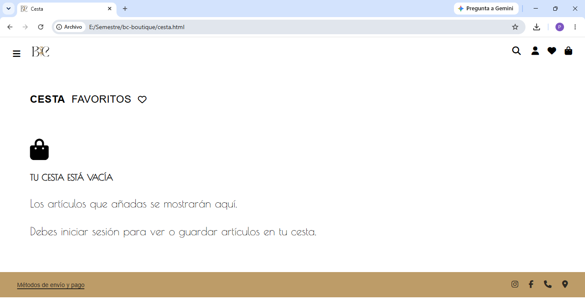
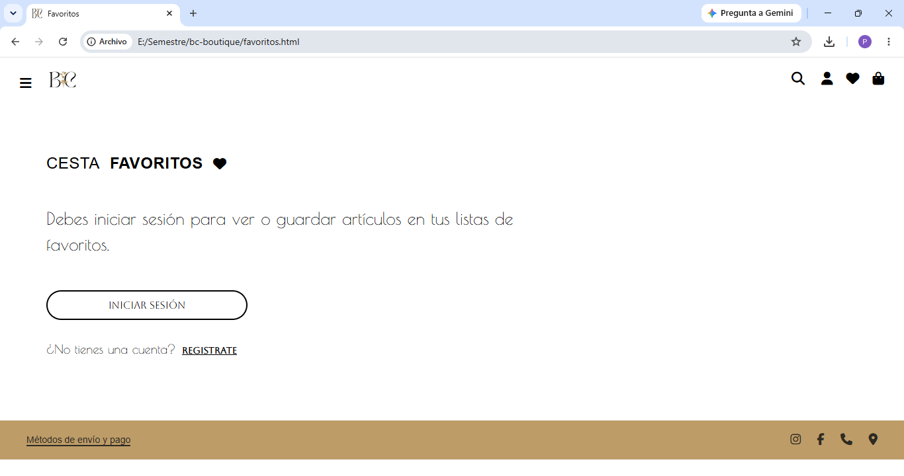
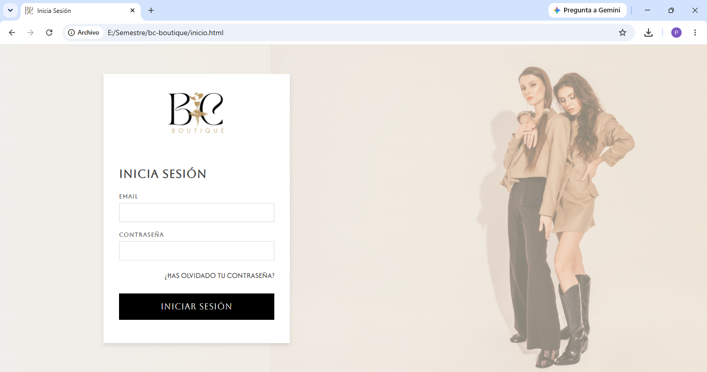
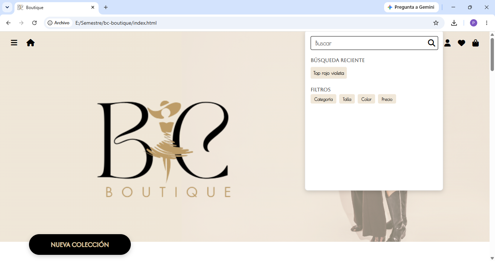
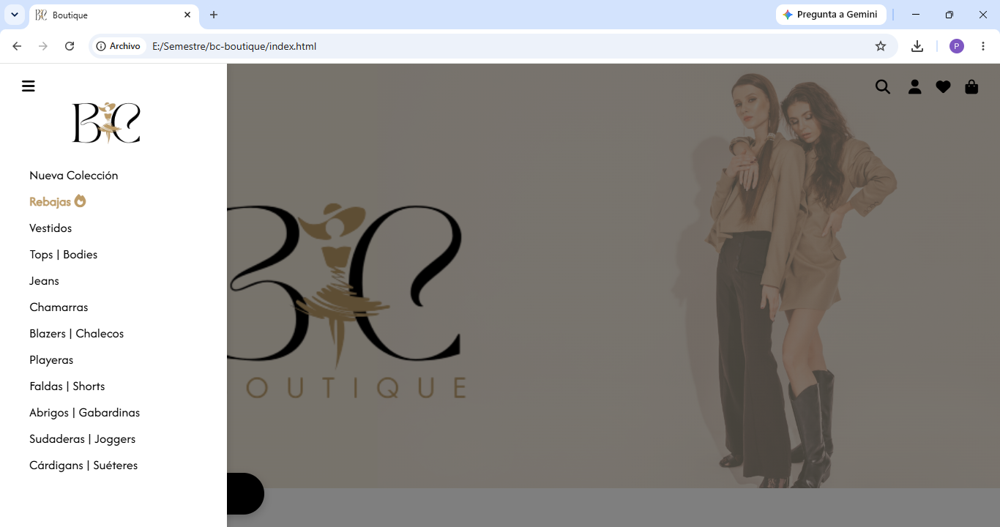

# BC Boutique

Web page for a boutique, designed from scratch as a UI/UX project. The full design was developed in Figma (18 screens) and later implemented with HTML, CSS, and JavaScript across 7 interactive pages.

---

## English

### About the project

BC Boutique is a static website for a fashion boutique, designed and coded from scratch for the **Interface Design and User Experience** course. The project covers the complete flow: design in Figma, front-end implementation, and interactive features like favorites, search, and a shopping cart.

**Design:** [View Figma file](https://www.figma.com/design/c2TiMDu4DdoOD15Pn974iY/IU?node-id=0-1&p=f&t=SXgQbtge4eQZHLt2-0) (18 screens)

### Team

| Member | Role |
| ------ | ---- |
| Katia Paola Victoria Escalera | Front-end development (HTML, CSS, JavaScript) |
| Isamar Chávez Díaz | UI/UX design |
| Ángel de Jesús Canela Figueroa | UI/UX design |

### Features

- **Home page** with hero section, new collection label, and featured products.
- **Product catalog** with 16 products, discount badges, and favorite toggle.
- **Product detail page** with size, color, and description.
- **Shopping cart** and **favorites** pages with login-gated views.
- **Login page** with custom styling.
- **Search modal** with recent searches and filter chips.
- **Mobile menu** with category navigation and a "Sale" highlight.
- **Responsive behavior** for the product grid and product detail view.

### Screenshots

**Home**


**Product catalog**


**Product detail**


**Shopping cart**


**Favorites**


**Login**


**Search modal**


**Mobile menu**


### How to run it

No installation or server required.

1. Clone the repository:
   ```bash
   git clone https://github.com/KPVE2004/bc-boutique.git
   cd bc-boutique
   ```
2. Open `index.html` in your browser (double-click, or use the *Live Server* extension in VS Code).
3. Navigate through the pages using the top icons or the mobile menu.

> The interface icons are loaded from a CDN (Font Awesome), so an internet connection is required to see them.

### Project structure

```
bc-boutique/
├── CSS/
│   ├── styles.css
│   ├── styles2.css
│   ├── styles3.css
│   ├── styles4.css
│   ├── styles5.css
│   └── styles6.css
├── JS/
│   └── app.js
├── docs/                    # Screenshots
├── img/                     # Product and UI images
├── index.html               # Home
├── productos.html           # Product catalog
├── chamarra.html            # Product detail (jacket)
├── tendencia.html           # Product detail (top)
├── cesta.html               # Shopping cart
├── favoritos.html           # Favorites
└── inicio.html              # Login
```

### Tech stack

HTML5 · CSS3 · JavaScript (ES6) · Font Awesome · Figma (design)

### Academic context

Interface Design and User Experience course — Instituto Tecnológico de Jiquilpan (TecNM).  
**Major:** Systems Engineering · **Specialty:** Intelligent Web-Mobile Application Development · **Term:** Jan – Jun 2025.

---

## Español

Página web para una boutique, diseñada desde cero como proyecto de UI/UX. El diseño completo se desarrolló en Figma (18 pantallas) y luego se implementó con HTML, CSS y JavaScript en 7 páginas interactivas.

### Sobre el proyecto

BC Boutique es un sitio web estático para una boutique de moda, diseñado y programado desde cero para la materia de **Diseño de Interfaz y Experiencia de Usuario**. El proyecto cubre el flujo completo: diseño en Figma, implementación frontend y funcionalidades interactivas como favoritos, búsqueda y cesta de compra.

**Diseño:** [Ver archivo de Figma](https://www.figma.com/design/c2TiMDu4DdoOD15Pn974iY/IU?node-id=0-1&p=f&t=SXgQbtge4eQZHLt2-0) (18 pantallas)

### Equipo

| Integrante | Rol |
| ---------- | --- |
| Katia Paola Victoria Escalera | Desarrollo frontend (HTML, CSS, JavaScript) |
| Isamar Chávez Díaz | Diseño UI/UX |
| Ángel de Jesús Canela Figueroa | Diseño UI/UX |

### Características

- **Página de inicio** con sección hero, etiqueta de nueva colección y productos destacados.
- **Catálogo de productos** con 16 productos, etiquetas de descuento y botón de favoritos.
- **Página de detalle** de producto con talla, color y descripción.
- **Cesta de compra** y **favoritos** con vistas protegidas por inicio de sesión.
- **Página de inicio de sesión** con estilos personalizados.
- **Modal de búsqueda** con búsquedas recientes y chips de filtros.
- **Menú móvil** con navegación por categorías y destacado de "Rebajas".
- **Comportamiento responsive** para la cuadrícula de productos y el detalle.

### Capturas

**Inicio**


**Catálogo de productos**


**Detalle de producto**


**Cesta de compra**


**Favoritos**


**Inicio de sesión**


**Modal de búsqueda**


**Menú móvil**


### Cómo ejecutarlo

No requiere instalación ni servidor.

1. Clona el repositorio:
   ```bash
   git clone https://github.com/KPVE2004/bc-boutique.git
   cd bc-boutique
   ```
2. Abre `index.html` en tu navegador (doble clic, o con la extensión *Live Server* de VS Code).
3. Navega por las páginas usando los íconos superiores o el menú móvil.

> Los íconos de la interfaz se cargan desde un CDN (Font Awesome), por lo que se necesita conexión a internet para verlos.

### Estructura del proyecto

```
bc-boutique/
├── CSS/
│   ├── styles.css
│   ├── styles2.css
│   ├── styles3.css
│   ├── styles4.css
│   ├── styles5.css
│   └── styles6.css
├── JS/
│   └── app.js
├── docs/                    # Capturas
├── img/                     # Imágenes de productos y UI
├── index.html               # Inicio
├── productos.html           # Catálogo de productos
├── chamarra.html            # Detalle de producto (chamarra)
├── tendencia.html           # Detalle de producto (top)
├── cesta.html               # Cesta de compra
├── favoritos.html           # Favoritos
└── inicio.html              # Inicio de sesión
```

### Tecnologías

HTML5 · CSS3 · JavaScript (ES6) · Font Awesome · Figma (diseño)

### Contexto académico

Materia de Diseño de Interfaz y Experiencia de Usuario — Instituto Tecnológico de Jiquilpan (TecNM).  
**Carrera:** Ingeniería en Sistemas Computacionales · **Especialidad:** Desarrollo de Aplicaciones Inteligentes Web-Móvil · **Periodo:** ene – jun 2025.

---

## Author · Autora

**Katia Paola Victoria Escalera**

[GitHub](https://github.com/KPVE2004) · [LinkedIn](https://www.linkedin.com/in/katia-victoria) · [Email](mailto:kp_victoria08@hotmail.com)
